<div align="center">

<a href="https://tryhindsight-bdd8hufna5e8bpgz.westus3-01.azurewebsites.net">
  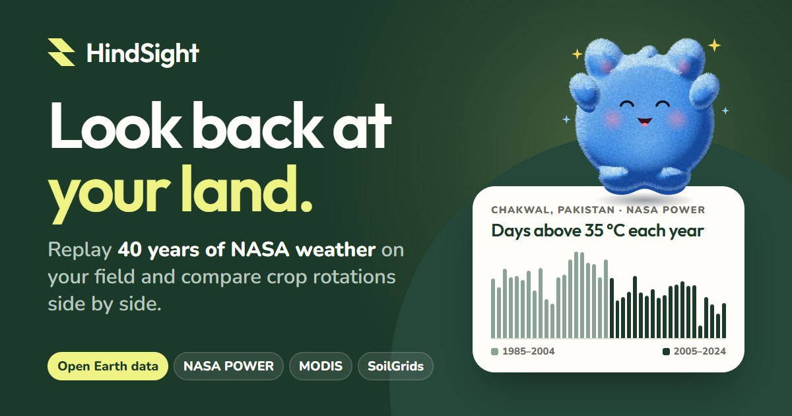
</a>

# HindSight

**Look back at your land. Make a more informed move forward.**

HindSight replays four decades of NASA Earth observations through a crop-water simulation,<br>
so a farmer can see how their crop rotation, and the alternatives, would have fared on the weather their land actually had.

<p>
  <a href="https://tryhindsight-bdd8hufna5e8bpgz.westus3-01.azurewebsites.net"></a>
  <a href="https://tryhindsight-bdd8hufna5e8bpgz.westus3-01.azurewebsites.net/app/demo"></a>
</p>

<p>
  
  
  
  
  
  
  
  
</p>

[**Try it live**](https://tryhindsight-bdd8hufna5e8bpgz.westus3-01.azurewebsites.net) ·
[The idea](#-the-idea) ·
[Features](#-features) ·
[How it works](#-how-it-works) ·
[Tech](#-technical-capabilities) ·
[Data &amp; credits](#-data-sources-and-credits) ·
[Run it locally](#-run-it-locally)

</div>

---

## 🌱 The idea

### The problem

A crop rotation is a multi-year bet. A farmer chooses what to grow, in what order, and when. That choice decides how much water the crops need, how often the soil lies bare when heavy rain arrives, and how the farm holds up in a dry year.

The weather those bets play out in is changing. Rain arrives in different amounts and at different times, there are more hot days, and the years that hurt the most are the ones a farmer remembers. Decisions are still made mostly on habit, an average year, or a neighbour's experience.

### What HindSight does

HindSight asks a simple, testable question:

> **How would this rotation, and the alternatives, have fared through the weather this land actually had?**

For any point on Earth it:

1. **Downloads 40 years of daily NASA weather** (1985–2024) and the soil under the field.
2. **Replays the farmer's current rotation and its alternatives day by day** through a crop-water model built on FAO-56, the standard method agronomists use for crop water use.
3. **Ranks the rotations against the farmer's own priorities** (stability, water, forage, nitrogen, erosion, organic matter, market) and **explains why**, in plain language, with the evidence and the gaps.

### What it is not

HindSight is honest about its limits, and the app says so on every screen where it matters:

| HindSight is… | HindSight is not… |
|---|---|
| A **historical decision-support simulation** | A yield forecast; it reports **no tonnes per hectare** |
| A comparison **relative to the alternatives evaluated** | A guaranteed recommendation |
| Built on **open, citable Earth data and published crop science** | An "AI" black box. The ranking is transparent arithmetic. |
| A way to ask **"what if the past had been drier or hotter?"** | A future climate projection. What-if scenarios are clearly labelled as adjustments to the past. |
| A starting point for a conversation | A substitute for local agricultural expertise |

---

## ✨ Features

<table>
<tr>
<td width="50%" valign="top">

### 🏡 Homepage and dashboard
A clear story of the problem and the method. The workspace dashboard summarises your field, climate, rotations, priorities, scenarios and brief in one place.

</td>
<td width="50%" valign="top">

### 🧭 Mascot-led first-visit tour
A friendly blue mascot walks new users through the dashboard. It spotlights each area, then flips and moves to the next. It is keyboard-accessible, respects reduced motion, can be skipped, and can be replayed from Help.

</td>
</tr>
<tr>
<td valign="top">

### 🗺️ Farm analysis in 7 steps
**Field & location** (map, place search, or one of 3 real demo farms) → **Soil & water** (SoilGrids suggestion, rainfed or irrigated) → **Crop rotation** (with a live calendar preview) → **Farming priorities** (four ready profiles or custom 0–5 weights) → **Scenario** → **Review** → **Results**.

</td>
<td valign="top">

### 📊 Results you can read
An overview of main indicators, a **side-by-side rotation comparison**, rotation details with the crop calendar, climate trends, **"Why these rotations?"** (reasons, benefits, evidence, information gaps) and a data & validation tab.

</td>
</tr>
<tr>
<td valign="top">

### 🌦️ Field Intelligence
Six lenses on one analysis:
- **Climate patterns:** 40 years of yearly values with early and late period means
- **Seasonal exposure:** when the soil is bare and the rain falls heavily
- **Rotation resilience:** tough years and rank robustness
- **Water resilience**
- **Soil care**
- **Location context:** coverage and data footprint

</td>
<td valign="top">

### 🧪 Scenario Lab
Change rainfall (for example −10% or −20%) and temperature (+1 °C or +2 °C), run up to 5 scenarios beside the baseline, and watch **how the rotation rankings respond**. Every run is labelled as a hypothetical adjustment to the historical record, never a forecast.

</td>
</tr>
<tr>
<td valign="top">

### 📄 Decision Brief
The whole analysis in one printable document: what was examined, how the current rotation performed, the top alternatives and why, trade-offs, and what remains uncertain. Export it as **PDF (print), CSV or JSON**.

</td>
<td valign="top">

### 💾 My Analyses (saved on this device)
Up to 20 analyses are kept in the browser, with no account and nothing stored on a server. Rename them, **compare 2–4 side by side**, export or import JSON, and delete with confirmation.

</td>
</tr>
<tr>
<td valign="top">

### 🎬 Guided demo tour
A 9-step, 5-minute story of a real Chakwal, Pakistan analysis: the challenge → the farm → historical conditions → current rotation → alternatives → trade-offs → a **live what-if run** → the brief → the takeaway. Built for judges and first-time visitors.

</td>
<td valign="top">

### 🔬 Science page
How the engine works, which data it uses, what it checks, and what it does not model, written for curious farmers and reviewers.

</td>
</tr>
</table>

**Throughout the app:** works on phones, tablets and desktops (checked at 360–1440 px) · keyboard navigation and screen-reader labels · reduced-motion support · saved results are always labelled as saved, never shown as live · link-preview banner for sharing.

---

## 📸 Screenshots

<table>
<tr>
<td width="50%">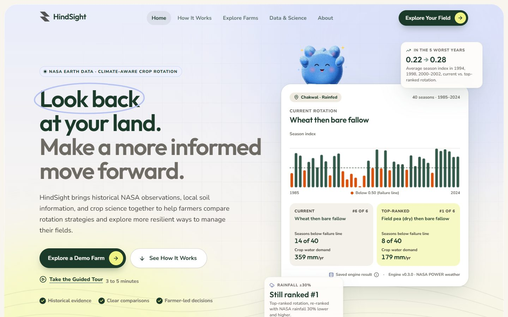<br><sub><b>Homepage:</b> the story and the method</sub></td>
<td width="50%">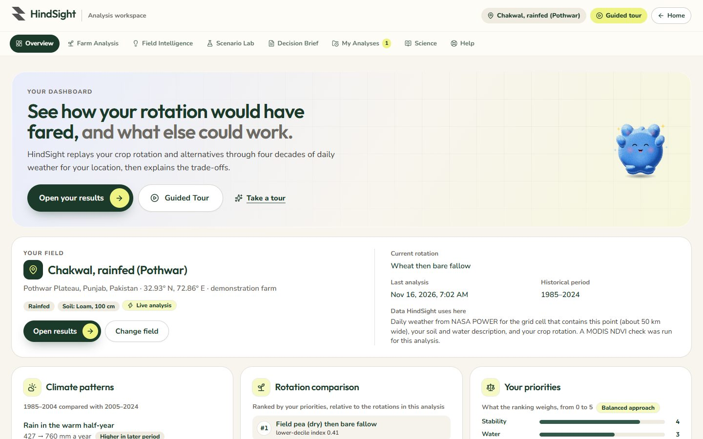<br><sub><b>Dashboard:</b> everything about your field at a glance</sub></td>
</tr>
<tr>
<td>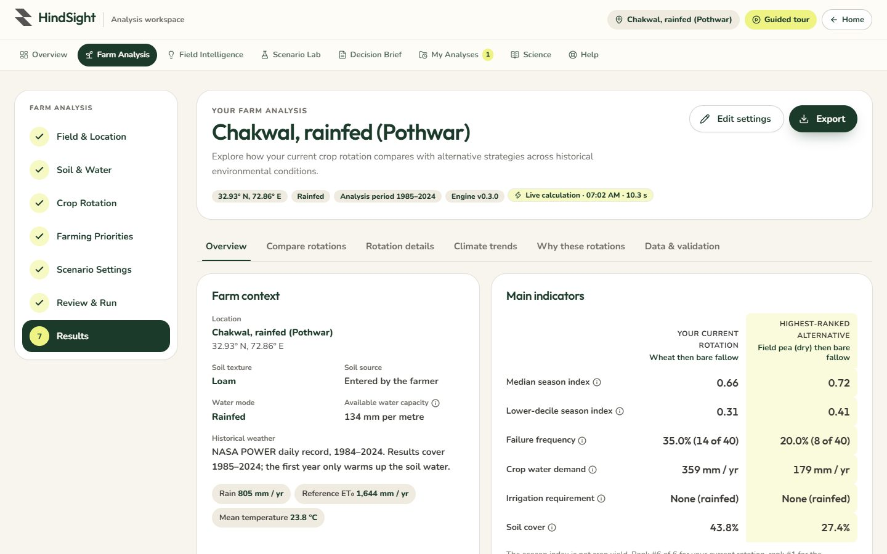<br><sub><b>Results:</b> current rotation vs the highest-ranked alternative</sub></td>
<td>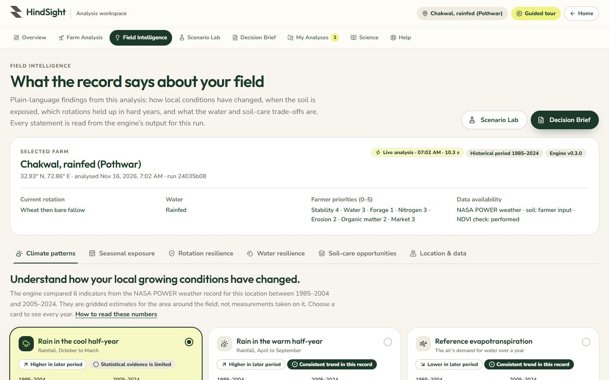<br><sub><b>Field Intelligence:</b> how conditions changed, 1985–2004 vs 2005–2024</sub></td>
</tr>
<tr>
<td>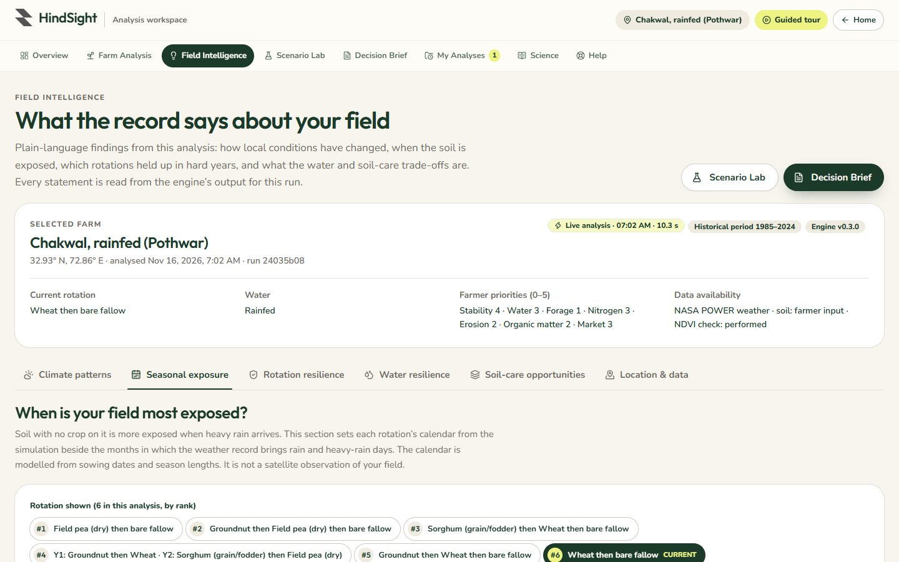<br><sub><b>Seasonal exposure:</b> bare-soil months and heavy rain</sub></td>
<td>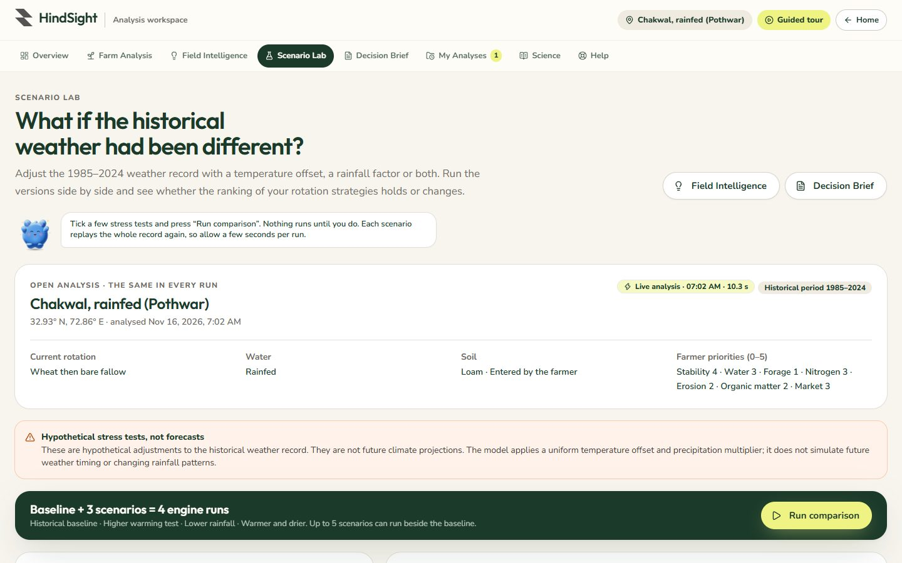<br><sub><b>Scenario Lab:</b> what if the past had been drier or hotter?</sub></td>
</tr>
<tr>
<td>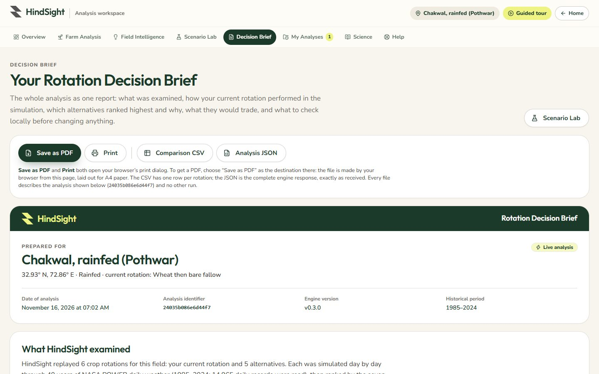<br><sub><b>Decision Brief:</b> print, PDF, CSV or JSON</sub></td>
<td>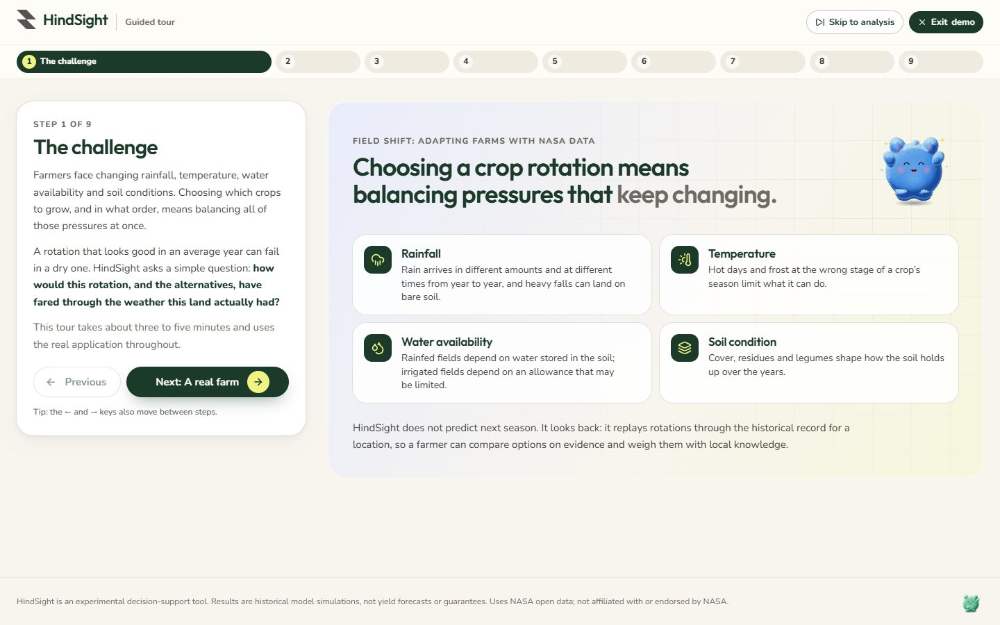<br><sub><b>Guided tour:</b> a real analysis in 9 steps</sub></td>
</tr>
</table>

<details>
<summary><b>📱 On a phone: the mascot dashboard tour</b></summary>
<br>
<p align="center">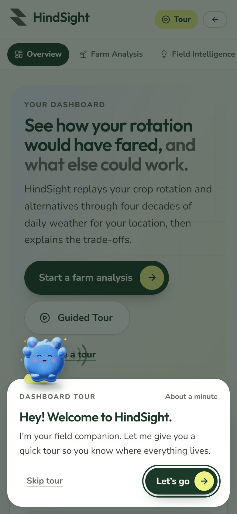</p>
</details>

---

## ⚙️ How it works

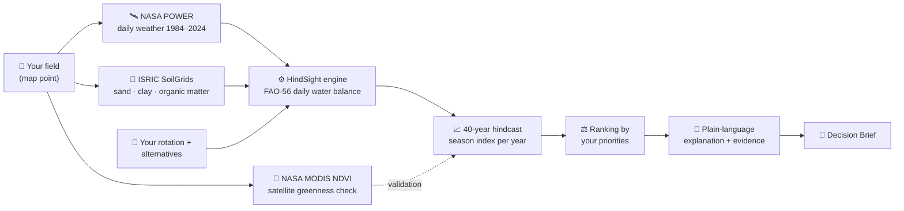

<details>
<summary><b>The engine, step by step (click to expand)</b></summary>

| Step | Method | Source |
|---|---|---|
| 1. Clean the weather | Drop 29 Feb; fill gaps with the record's day-of-year mean; missing solar radiation from the Hargreaves formula | FAO-56 eq. 50 |
| 2. Reference evapotranspiration | FAO Penman–Monteith, daily | FAO-56 eq. 6 |
| 3. Soil water | Field capacity and wilting point from sand, clay and organic matter | Saxton & Rawls 2006 |
| 4. Daily water balance | Root-zone bucket, water-stress coefficient, rain and irrigation | FAO-56 ch. 8 |
| 5. Crop curves | Four-stage crop coefficient curve; roots grow through the season | FAO-56 ch. 6 |
| 6. Season index | Yield-response factor on the water deficit × temperature factor × legume effect; frost kill | FAO-33/66, EcoCrop, Zhao et al. 2022 |
| 7. Hindcast | One run per starting phase; one index per year, 1985–2024 | — |
| 8. Ranking | Min–max normalised indicators, farmer weights 0–5, Pareto-efficient mark | — |
| 9. Climate shift | 1985–2004 vs 2005–2024; Theil–Sen slope; Kendall p-value | SciPy |
| 10. Explanations | Fixed templates filled only from the numbers above | — |

Full detail: [`docs/METHODOLOGY.md`](docs/METHODOLOGY.md).
</details>

<details>
<summary><b>How HindSight tests its own answers</b></summary>

- **Worst-years test:** finds the 5 hardest years for the farmer's current rotation and reports how every alternative did in those same years. Would it have protected you when it mattered most?
- **Rank robustness (legume effect):** the least certain parameter (+7% to +32% in the literature) is varied at 0 / 7 / 20 / 32%, and each rotation's rank range is reported.
- **Rank robustness (rainfall):** NASA POWER rainfall can differ from local gauges, so every rotation is re-simulated with rainfall ×0.7 and ×1.3.
- **Satellite check:** MODIS NDVI greenness is compared with the simulated season index, and the result is reported whatever it is.
- **Physics checks:** water mass balance closes within 0.1 mm over 41 years; reference ET matches FAO-56 Example 18 within 5%; the model is deterministic.

See [`docs/VALIDATION.md`](docs/VALIDATION.md).
</details>

### 🌍 Demonstration farms

| Farm | Setting | Current rotation |
|---|---|---|
| **Chakwal, Pakistan** | Rainfed, Pothwar plateau | Wheat then bare fallow |
| **Sheikhupura, Pakistan** | Fully irrigated, Punjab plains | Cotton then wheat, each year |
| **Ames, Iowa, USA** | Rainfed, US Corn Belt | Maize one year, soybean the next |

You can also drop a pin **anywhere** and HindSight fetches that location's weather and soil live.

**Crops available:** wheat, maize, sorghum, cotton, soybean, groundnut, field pea, sunflower, potato. Five more (rice, chickpea, mung bean, pearl millet, mustard) are in the dataset but switched off until their water-response factor is verified against a published table. **No unverified crop is used silently.**

---

## 🛠️ Technical capabilities

<table>
<tr>
<td width="50%" valign="top">

**Scientific engine (Python)**
- Pure-Python, deterministic FAO-56 crop-water engine (v0.3.0)
- About 0.3 s of compute per rotation run over 41 years
- NumPy and SciPy for the maths and statistics
- Explanations generated only from computed numbers

**API (FastAPI)**
- Background analysis jobs with progress stages
- Stateless scenario comparison (up to 6 runs per request; weather and soil read once)
- Cached weather and soil, so demo farms run offline
- Validated input with friendly error messages, no stack traces shown to users
- Gzip compression; long-term caching of fingerprinted assets

</td>
<td width="50%" valign="top">

**Frontend (React + TypeScript)**
- React 19, strict TypeScript, Vite 8, Tailwind CSS v4
- Hand-built SVG charts (no chart library), Leaflet map
- Code split by page; the workspace preloads in the background
- All interpretation rules in one tested module (`insights.ts`)
- Responsive from 360 px phones to 1440 px desktops
- Keyboard navigation, focus management, reduced motion

**Quality and delivery**
- **124 backend tests** (pytest) and **75 frontend tests** (Vitest)
- Browser end-to-end scripts with Playwright
- CI/CD with GitHub Actions: test → build → deploy → live check of all 3 demo farms
- Hosted on Microsoft Azure App Service (Linux)

</td>
</tr>
</table>

<details>
<summary><b>API endpoints</b></summary>

| Method | Endpoint | What it does |
|---|---|---|
| `GET` | `/api/health` | Engine and API version, number of presets, hindcast years |
| `GET` | `/api/presets` | The three demonstration farms |
| `GET` | `/api/crops` | Verified crops and input limits |
| `GET` | `/api/rotation-library` | Ready-made rotations |
| `POST` | `/api/rotation/preview` | Calendar preview of a rotation |
| `POST` | `/api/soil/lookup` · `/api/soil/resolve` | SoilGrids soil for a point |
| `GET` | `/api/geocode` | Place search |
| `GET` | `/api/demo/{preset}` | Saved demonstration result, clearly labelled as saved |
| `POST` | `/api/analyze/preset/{preset}` | Live analysis of a demo farm |
| `POST` | `/api/analyze` | Start an analysis job (any location) |
| `POST` | `/api/scenarios/compare` | Run several what-if scenarios or priority profiles side by side |
| `GET` | `/api/analysis/{id}` | Poll a job's progress and result |

</details>

<details>
<summary><b>Project structure</b></summary>

```text
HindSight/
├── backend/
│   ├── engine/          # the scientific engine: et0, soil, season, rotation, ranking, trends, explain
│   ├── data_sources/    # NASA POWER, SoilGrids and MODIS NDVI clients with caching
│   ├── data/            # crops, rotations, presets, cached weather and soil, saved demo results
│   ├── api.py           # FastAPI app (also serves the built frontend)
│   ├── context.py       # yearly and monthly climate context for every result
│   └── tests/           # 124 pytest tests
├── frontend/
│   ├── src/sections/    # homepage
│   ├── src/app/         # workspace: pages, steps, results, insights, scenarios, brief, demo
│   ├── src/components/  # shared UI, brand, dashboard tour
│   └── public/          # fonts, mascots, logo, link-preview banner
├── scripts/             # data fetchers, browser tests, Azure startup, banner generator
├── docs/                # methodology, data sources, validation, AI use, screenshots
└── .github/workflows/   # build, test and deploy to Azure
```
</details>

---

## 📚 Data sources and credits

### NASA and Earth data

| Source | Used for |
|---|---|
| [NASA POWER](https://power.larc.nasa.gov/) | Daily weather, 1984–2024, for any point |
| [MERRA-2](https://gmao.gsfc.nasa.gov/reanalysis/MERRA-2/) | The reanalysis behind POWER's weather data |
| [NASA MODIS MOD13Q1 v6.1](https://doi.org/10.5067/MODIS/MOD13Q1.061) | NDVI vegetation index, used as a satellite check |
| [ORNL DAAC MODIS Web Service](https://modis.ornl.gov/) | How the NDVI is fetched |
| [ISRIC SoilGrids 2.0](https://soilgrids.org/) | Sand, clay and organic matter under the field |
| [OpenStreetMap](https://www.openstreetmap.org/copyright) | Map tiles |
| [Nominatim](https://nominatim.org/) | Place search on the map |

### Crop science

| Source | Used for |
|---|---|
| [FAO-56 Crop Evapotranspiration](https://www.fao.org/4/x0490e/x0490e00.htm) | Reference ET, crop coefficients, water balance |
| [FAO-33 / FAO-66 Crop yield response to water](https://www.fao.org/4/i2800e/i2800e.pdf) | Yield-response factors (Ky) |
| [FAO EcoCrop](https://gaez.fao.org/pages/ecocrop) | Crop temperature limits |

### Software

| Backend | Frontend | Testing and delivery |
|---|---|---|
| [Python](https://www.python.org/) | [React](https://react.dev/) | [pytest](https://pytest.org/) |
| [NumPy](https://numpy.org/) | [TypeScript](https://www.typescriptlang.org/) | [Vitest](https://vitest.dev/) |
| [SciPy](https://scipy.org/) | [Vite](https://vite.dev/) | [Playwright](https://playwright.dev/) |
| [FastAPI](https://fastapi.tiangolo.com/) | [Tailwind CSS](https://tailwindcss.com/) | [GitHub Actions](https://github.com/features/actions) |
| [Uvicorn](https://www.uvicorn.org/) | [React Router](https://reactrouter.com/) | [Microsoft Azure App Service](https://azure.microsoft.com/products/app-service/) |
| [Pydantic](https://docs.pydantic.dev/) | [Leaflet](https://leafletjs.com/) | [Node.js](https://nodejs.org/) |
| [Requests](https://requests.readthedocs.io/) | [Lucide icons](https://lucide.dev/) | |

**Fonts:** [Outfit](https://fonts.google.com/specimen/Outfit) and [Nunito](https://fonts.google.com/specimen/Nunito), both under the SIL Open Font License.

**AI assistance:** [Claude](https://claude.ai/) and [Claude Code](https://claude.com/claude-code) by Anthropic helped draft code, tests and documentation, with every file reviewed by the team. HindSight itself uses no AI. See [`docs/AI_USE.md`](docs/AI_USE.md) for exactly which files and how.

---

## 💻 Run it locally

**You need:** Python 3.14 and Node.js 24.

```bash
# 1. Backend: the engine and the API on http://127.0.0.1:8000
python -m venv .venv
.venv/Scripts/activate            # Windows  (macOS/Linux: source .venv/bin/activate)
pip install -r backend/requirements.txt
python -m uvicorn backend.api:app --port 8000

# 2. Frontend: the site on http://127.0.0.1:5173 (in a second terminal)
cd frontend
npm ci
npm run dev
```

The three demo farms work offline because their weather and soil are cached in `backend/data/cache/`. A custom location downloads its data from NASA POWER and SoilGrids the first time.

<details>
<summary><b>Tests and production build</b></summary>

```bash
python -m pytest backend/tests -q        # 124 backend tests
cd frontend && npm test                  # 75 frontend tests
npm run build                            # type-check and production build into frontend/dist
```

When `frontend/dist` exists, the API also serves the built site, so one process runs the whole app:
`python -m uvicorn backend.api:app --port 8000` → http://127.0.0.1:8000
</details>

<details>
<summary><b>Deployment</b></summary>

Every push to `main` runs [`.github/workflows/main_tryhindsight.yml`](.github/workflows/main_tryhindsight.yml):

1. **Test and build:** backend tests, frontend tests, production build, then package.
2. **Deploy:** sign in to Azure (OIDC; no stored passwords), configure the App Service (Python 3.14, startup command, persistent weather cache on `/home`), and deploy.
3. **Verify live:** health check, homepage, deep links, assets, and a **real engine run for all three demo farms** on the deployed site.

Secrets live only in GitHub and Azure settings, never in the repository.
</details>

---

## ⚠️ Limitations

We would rather you trust HindSight a little and correctly than a lot and wrongly.

- **Weather is a ~50 km grid-cell estimate**, not a field measurement. Rainfall can differ markedly from local gauges (+48% at Chakwal and −36% at Sheikhupura against published normals), which is why every ranking is re-tested with rainfall ±30%.
- **Not modelled:** pests, disease, nutrients, salinity, crop variety, management, runoff by slope, and percolation in flooded rice.
- **The season index is relative**, for comparing rotations at the same place. It is not a yield.
- **What-if scenarios** apply a uniform temperature offset and rainfall multiplier to the past. They do not simulate future weather timing or changing rainfall patterns.
- **Saved analyses** live only in your browser on this device.

More in [`docs/METHODOLOGY.md`](docs/METHODOLOGY.md) and [`docs/DATA_SOURCES.md`](docs/DATA_SOURCES.md).

---

## 📖 Documentation

| Document | What's inside |
|---|---|
| [`docs/METHODOLOGY.md`](docs/METHODOLOGY.md) | The engine, its assumptions and what it does not model |
| [`docs/DATA_SOURCES.md`](docs/DATA_SOURCES.md) | Every dataset, its resolution, limits and citation |
| [`docs/VALIDATION.md`](docs/VALIDATION.md) | Checks the engine passes and how it was validated |
| [`docs/ENGINE_CHANGELOG.md`](docs/ENGINE_CHANGELOG.md) | What changed in each engine version |
| [`docs/AI_USE.md`](docs/AI_USE.md) | Where AI assistance was used, file by file |
| [`frontend/README.md`](frontend/README.md) | Frontend routes, structure and tests |

---

<div align="center">

**HindSight** is a [NASA Space Apps Challenge 2026](https://www.spaceappschallenge.org/) project.<br>
<sub>Not affiliated with or endorsed by NASA. HindSight provides historical decision-support simulations. Rankings are relative to the alternatives and assumptions evaluated. They are not guaranteed recommendations, yield forecasts, or substitutes for local agricultural expertise.</sub>

<br><br>

<a href="https://tryhindsight-bdd8hufna5e8bpgz.westus3-01.azurewebsites.net"><b>🌾 Look back at your land →</b></a>

</div>
